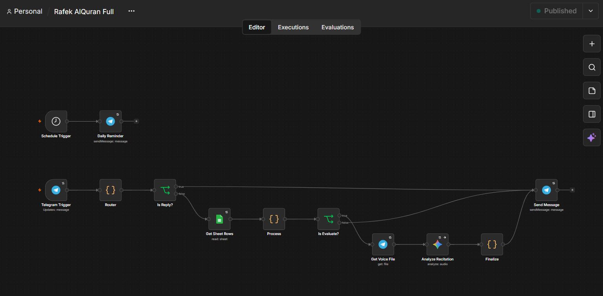
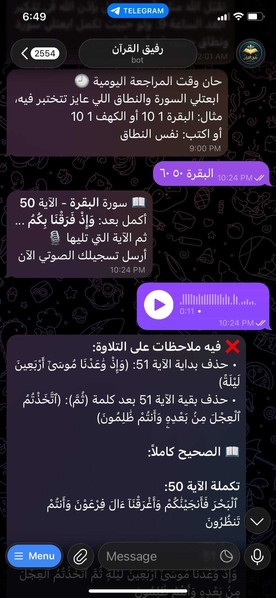

# 🕌 Rafek: AI-Powered Quran Recitation Evaluator

An intelligent Telegram bot that acts as a virtual Quran companion. Users can select a specific Surah and range of Ayahs, and the bot will randomly prompt them to complete a verse via voice note. The system uses Google Gemini's audio processing capabilities to evaluate the recitation against a Google Sheets database and provides immediate, detailed feedback.

## 🧠 System Architecture

## 📱 Bot Output Example

## 🚀 Key Features
* **Interactive State Management:** Custom JavaScript router handles user sessions, commands (`/start`, `/stop`), and tracks current testing states.
* **Dynamic Audio Evaluation:** Accepts Telegram voice notes and processes them using Google Gemini 3.5 Flash for highly accurate, Arabic-text evaluation.
* **Prompt Engineering:** Strict system prompts instruct the LLM to ignore Tajweed nuances and focus strictly on word accuracy and Harakat (diacritics).
* **Database Integration:** Fetches verified, diacritic-rich Quranic text dynamically from a Google Sheet based on the user's current Ayah.

## ⚙️ How It Works
1. **Telegram Trigger:** Listens for text commands or voice notes.
2. **JS Router:** Analyzes the input, validates Surah numbers/ranges, and manages the session state.
3. **Data Retrieval:** Queries Google Sheets for the exact verse and the subsequent verse.
4. **Gemini Analysis:** Sends the voice file and the expected text to Gemini with a custom evaluation schema.
5. **Feedback Loop:** Parses the JSON response from Gemini and sends a formatted Telegram message with corrections.

## 🛠️ Tech Stack
* **Workflow Automation:** n8n
* **AI & LLM:** Google Gemini 3.5 Flash
* **APIs:** Telegram Bot API, Google Sheets API
* **Custom Code:** JavaScript (Node.js) for routing, text normalization, and JSON parsing.
